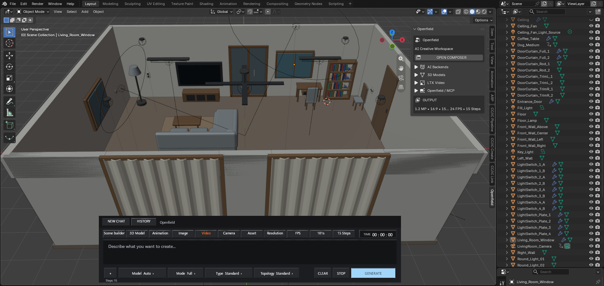

# Openfield

### AI-assisted 3D & Video Creation

> 🚧 **COMING SOON**

Openfield is an upcoming creative workspace focused on making AI-assisted
3D and video creation more accessible.

## Workflow

**Python → AI Inference → GPU → ComfyUI → Blender → 3D / Video**

## The Idea

I want everyone to be able to use this for free.

If you have a **high-end PC with a powerful GPU** capable of running **Minimax H3, LTX, and Union Control**, you can use the full workflow for free.

No high-end GPU? I'm working on lower **resolution, steps, FPS, and frame counts** so more people can use it.

## Demo

The floating Blender UI shown above is a **demo interface** showing the direction of the project.

**Openfield is currently under development and is not publicly available yet.**

## What I'm Working Toward

- AI-assisted 3D creation
- AI video generation
- Blender-based creative workflows
- GPU-based AI inference
- Flexible quality settings for different GPU capabilities
- Free access wherever possible

## Vision

Advanced AI creative tools should not be limited only to people with expensive hardware.

Openfield is being developed with the goal of making AI-assisted
**3D and video creation more accessible, flexible, and free to use.**

## Status

🚧 **Coming Soon**

The project is still under development.

There is currently no public release or download available.

---

**Openfield — Create more. Build freely.**
